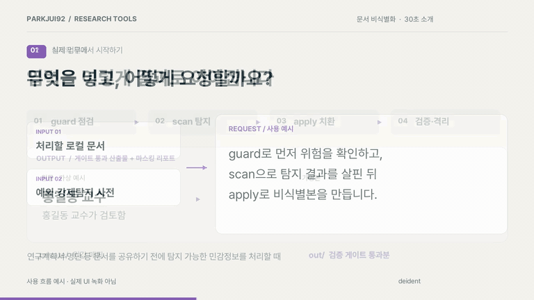

# deident — 한국 문서 민감정보 비식별화

**문서 속 이름·기관 등 민감정보를 찾아 가명으로 바꾸고, 결과를 재검사하는 로컬 실행 도구입니다.**

예를 들어 문서에 두 번 나온 `홍길동 교수`를 두 곳 모두 `[연구자A] 교수`로 바꿉니다. 탐지·치환에 외부 API를 사용하지 않으며, 검증 게이트를 통과한 파일만 `out/`에 둡니다. HWPX·워드·엑셀·발표자료는 서식을 보존하는 방식으로 처리하고, PDF는 내용 제거, 구형 HWP는 텍스트 추출 경로를 씁니다.

## 30초 소개

[](docs/media/intro.mp4)

*가상 문서로 실제 실행한 명령·출력을 재생한 30초 영상입니다. 이름·기관을 사전에 등록한 예제입니다.*

## 실제로는 이렇게 씁니다

**예: 연구책임자 이름과 소속이 들어 있는 문서를 공유하기 전.** 원본은 `intro-work/in/`, 이름·기관을 지정한 사전은 `intro-work/config/`에 둡니다. 아래 [가상 문서 실행 예제](#가상-문서로-처음-실행하기)로 준비할 수 있습니다.

```bash
python3 run.py --root intro-work scan   # 탐지 결과 확인
python3 run.py --root intro-work apply  # 가명 치환 → 재검사
```

이번 가상 문서를 실제 실행한 결과입니다. 이름·기관을 사용자 사전에 명시했으므로 **자동 탐지 성능이 아닌 치환·검증 흐름**을 보여줍니다.

```text
탐지 3건: 성명 2건, 기관 1건
게이트: 통과 (재탐지 0, 원값 잔존 0)
산출: intro-demo.비식별.md
```

| 원본 문서 | 실제 산출물 |
|---|---|
| 연구책임자: 홍길동 교수 | 연구책임자: [연구자A] 교수 |
| 소속: 미래정책연구원 | 소속: [기관A] |
| 홍길동 교수가 검토함. | [연구자A] 교수가 검토함. |

**확인할 결과:** `intro-work/out/intro-demo.비식별.md`를 열어 치환 상태를 확인합니다. 원값↔가명 매핑은 `intro-work/_private/mapping.json`에 별도로 남습니다.

**차별점:** 탐지·치환을 로컬에서 수행하고, 같은 인물은 같은 가명으로 바꾸며, 검증 게이트 불합격 결과를 격리합니다. 게이트 통과가 탐지 누락이나 문맥에 의한 재식별까지 없다는 뜻은 아니므로 공유 전 결과를 직접 확인하세요.

## 무엇이 다른가

개인정보를 찾아 가리는 도구는 이미 많다. deident는 그 가운데 **한국 기관이 실제로 주고받는
문서 파일**을 대상으로 아래 일을 한 번에 한다.

- **서식을 지킨 가명 사본** — `.hwpx`·`.docx`·`.pptx`·`.xlsx`를 원래 형식 그대로 고쳐 쓴다.
  표·글상자·머리말·각주·발표자 노트가 남고, AI에 넣을 마크다운이 함께 나온다.
  글자만 뽑아 가리는 방식으로는 양식 문서를 돌려줄 수 없다.
- **`●●●` 대신 `[연구자A]`** — 같은 사람·같은 기관은 어디서나 같은 가명을 받아, 가린 뒤에도
  누가 무엇을 맡는지 읽힌다. 원값↔가명 매핑은 격리 폴더에만 남고 `restore`로 되돌린다.
- **표가 알려 준 이름을 문서 전체에서 지운다** — 참여연구원 표의 `성명`·`소속` 칸에서 값을
  건져 대장에 올린 뒤, 본문·각주·도형 이름에 흩어진 같은 값을 찾는다. 자간을 벌린 표기
  (`홍 길 동`)와 앞뒤에 글자가 붙은 자리(`발표자홍길동`)까지 훑는다. 대형 NER 모델이나 GPU 없이 돈다.
- **화면에 안 보이는 자리까지 고친다** — 시트 이름, 숫자로 저장된 주민등록번호, 셀 메모,
  책갈피, 도형 대체 텍스트, 차트에 딸린 엑셀, 스마트아트, PDF 주석·책갈피·첨부 파일.
  이런 자리 48곳을 자리 하나당 합성 문서 하나로 만들어 매번 시험한다.
- **통과한 것만 `out/`에 있다** — 치환을 마친 파일을 다시 열어 같은 탐지기로 재검사하고,
  매핑에 오른 원값이 파일 안 어디에든(글자·속성값·압축 안의 압축까지) 남았는지 찾는다.
  하나라도 걸리면 그 실행의 산출물 전부를 격리한다. `out/`에 파일이 있다는 사실이 곧 통과 기록이다.
- **개인정보 밖의 것도 가린다** — 소속 기관, 과제번호, 예산, 직접 지정한 기밀어.
  연구계획서를 내보낼 때 걸리는 것은 주민등록번호만이 아니다.
- **외부 AI에 원문을 보내지 않는다** — 기본 탐지는 로컬 파이썬이고 요약은 `홍*동` 식으로
  가려진다. `--llm`을 켜면 아직 탐지되지 않은 내용은 이 컴퓨터의 Ollama 모델에 전달된다.
  외부 주소·프록시·리디렉션은 허용하지 않는다.
- **못 본 것을 없다고 하지 않는다** — 열지 못한 파일과 미지원 형식은 '탐지 없음'으로 넘기지
  않고 '확인 필요'로 보고한다(종료 코드 3).

## 왜 이렇게 만들었나

문서를 AI에 넣기 전에 개인정보를 지우려는데, **지우는 과정에서 AI가 원문을 읽으면**
아무 의미가 없다. 그래서 탐지·치환을 전부 로컬 파이썬 코드에 두고, AI(또는 사람)가
보는 것은 `홍*동` 식으로 가려진 요약만 되게 했다.

안전을 규율이 아니라 **구조**로 보장하는 네 가지 불변식:

1. **외부 전송 없음** — 탐지·치환은 로컬. 선택한 로컬 LLM은 미탐지 원문을 읽지만,
   외부 서비스에는 전송하지 않는다. 요약에는 마스킹된 값만 실린다.
2. **out/ 불변식** — 검증 게이트를 통과한 파일만 `out/`에 존재한다. 하나라도
   불합격이면 그 실행의 산출물 전부를 격리한다. 부분 통과는 없다.
3. **매핑 격리** — 원값↔가명 매핑과 원문 대조 리포트는 `_private/`(권한 700)에만.
4. **stdout 위생** — 트레이스백에 원문 조각이 섞이지 않게, 전문은 로그 파일로만.

---

## 설치

파이썬 3.11 이상. 표준 라이브러리 + 아래 선택 의존성.

```bash
git clone https://github.com/parkjui92/deident.git
cd deident
python3 -m pip install -r requirements.txt       # 필수
python3 -m pip install -r requirements-full.txt  # 한국어 인명·PDF·엑셀·구형 한글 (권장)
```

선택 라이브러리가 없으면 해당 기능을 사용할 수 없습니다. 한국어 인명 탐지에는
`kiwipiepy` 설치를 권장합니다. 검사할 수 없는 파일은 통과로 간주하지 않습니다.

```bash
mkdir -p work/in work/config
cp config.example/* work/config/   # 작업 폴더 준비
python3 run.py --root work guard "work/in/문서.hwpx"
```

### 가상 문서로 처음 실행하기

설치 후 저장소 폴더에서 실행합니다. 아래 연습은 새 `intro-work/` 폴더를 만들며,
사전에 이름·기관을 명시해 **탐지 성능이 아닌 치환·검증 흐름**을 확인합니다.

```bash
mkdir -p intro-work/in intro-work/config
cp config.example/* intro-work/config/
cp examples/intro-demo.md intro-work/in/
printf '\n홍길동,person\n미래정책연구원,org\n' >> intro-work/config/denylist.txt
python3 run.py --root intro-work apply intro-work/in/intro-demo.md
```

`intro-work/out/intro-demo.비식별.md`에서 `홍길동 교수`가 `[연구자A] 교수`로 바뀌고,
다시 나오는 이름도 같은 가명인지 확인하세요. 실제 문서를 처리할 때는 자동 탐지 결과와
사용자 사전을 함께 점검합니다. `intro-work/`의 원문·매핑 파일은 저장소에 커밋하지 않습니다.

---

## 사용

```bash
python3 run.py guard "문서.hwpx"    # ① 열기 전 점검 (읽기 전용)
python3 run.py scan  "문서.hwpx"    # ② 무엇이 얼마나 잡히나 (파일 변경 없음)
python3 run.py apply "문서.hwpx"    # ③ 비식별본 생성 + 검증 게이트
```

작업 폴더는 `--root` 또는 환경변수 `DEIDENT_ROOT`, 없으면 현재 폴더.

| 명령 | 하는 일 | 종료 코드 |
|---|---|---|
| `guard` | 위험도만 빠르게 판정 | 0 없음·참고 / 3 주의 이상 **또는 검사 불가** |
| `scan` | 탐지 + 리포트 | 0 |
| `apply` | 탐지 → 치환 → 위생 → 게이트 → 리포트 | 0 통과 / 2 게이트 불합격 |
| `verify` | 산출물만 재검증 | 0 / 2 |
| `restore` | 가명 → 원값 (`_private/restored/`에만) | 0 |
| `selftest` | 합성 문서로 탐지 재현율 확인 | 0 통과 / 2 놓침 |

옵션: `--strict-only`(확실 등급만) · `--mask`(●●●, 복원 불가) · `--quick`(guard 빠른 검사) ·
`--llm`(이 컴퓨터의 언어모델로 후보 보태기 — 아래 "로컬 LLM")

### 폴더

```
in/         원문
out/        ★ 게이트를 통과한 산출물만 여기 온다
_private/   원값이 있는 유일한 구역 (700)
  mapping.json · *.report_full.html · failed/ · restored/ · logs/
config/     allowlist.txt · denylist.txt · settings.yaml · confidential_rules.yaml
```

---

## 어떻게 찾는가

| 계층 | 방법 | 잡는 것 |
|---|---|---|
| **L1** | 정규식 + 검증식 | 주민등록번호·외국인등록번호·여권·면허·전화(괄호 표기·내선·해외 번호·한글로 풀어 쓴 번호)·이메일(`골뱅이`·`dot`로 풀어 쓴 것)·카드·계좌·사업자/법인번호·차량·주소(공동주택 이름·건물 호실)·생년월일·메신저 계정·사번·학번·과제번호 |
| **L2** | 문서 구조 (주력) | 표 머리글(`성명`·`소속`·`생년월일`)이 지목한 칸의 값을 건져 대장에 올리고 문서 전체로 전파 |
| **L3** | 형태소 + 문맥 단서 | 표 밖의 이름 — 본문 이름표(`참석: …`), 이름 뒤 직함(`육동현 단장`), 이름 앞 신분(`석사과정 황보람`), 성+직함(`탁 책임은`), 이름만 부른 표기(`지훈이`·`세린 씨`), 영문·외국인 이름. 기관 — 접미사(`~연구원`·`~대학교`), 통용 약칭(`화학연`·`포스텍`), 회사 표지(`㈜…`), 기관 뒤 학과·부서 |
| **L4** | 로컬 LLM (선택, 기본 꺼짐) | 규칙이 원리상 못 잡는 것 — 접미사 없는 회사 이름, 단서 없는 본문 이름, 이름 없는 식별 서술 |
| 사전 | 사용자 지정 | `denylist`(강제 탐지)·`allowlist`(예외)·`confidential_rules`(과제번호·예산·기밀어) |

**이름은 L2가 주력이다.** 형태소 분석기는 사전에 없는 이름을 쪼갠다(`박서준` → 박/서/준).
표에서 확실하게 건진 이름을 사전에 등록한 뒤 전파하는 편이 훨씬 정확하다.

**단서 규칙은 과탐과 짝이다.** `교수 연구실`의 `연구실`, `반도체 시장`의 `반도체`,
`10명 위원`의 `명`도 같은 모양이다. 그래서 후보가 사전에 있는 보통 낱말이면 버리고
(형태소 분석기로 판정), 이름에 쓰이지 않는 음절이 섞이면 버리고(`사노피`·`유전체`),
행정구역·나라 이름은 사전으로 거른다. 본문 인용(`홍길동(2020)`, `(김철수 외, 2019)`)의
저자는 건드리지 않는다. 규칙마다 '잡아야 하는 것'과 '잡으면 안 되는 것'을 짝으로
시험한다(`tests/test_rules.py`).

**체크섬은 탈락 근거가 아니다.** 2020년 10월 이후 발급된 주민등록번호는 뒷자리가
무작위여서 옛 검증식을 통과하지 않는다. 검증식으로 걸러 내면 최신 번호를 통째로 놓친다.

**마무리 훑기.** 한 번 민감하다고 판정한 값은 문맥이 없는 자리에서도 지운다 —
자간을 벌려 쓴 표기(`한 국 화 학`), 앞뒤에 글자가 붙은 자리(`발표자홍길동`),
줄바꿈이 끼어든 이름, 도형 이름·대체 텍스트 같은 XML 속성까지. 전부 실문서에서
실제로 남았던 자리다.

**숨은 자리.** 본문과 표만 읽으면 문서의 절반만 본 것이다. 글자는 XML 속성(시트 이름·
책갈피·도구 설명·링크 주소)과 곁가지 파일(메모·차트·스마트아트·문서 속성), 문서 안에
통째로 든 다른 문서(차트 데이터 엑셀)에도 산다. 이 자리들을 추출 단계에서 함께 올려
탐지·치환·게이트가 같은 것을 보게 한다. 치환기만 따로 훑으면 점검 결과는 '없음'인데
파일에는 남는다. 숨은 자리에서 잡힌 것은 리포트에 그 자리 이름(`xl/comments/…`,
`page1/annot`)으로 나오고, AI 입력용 마크다운에는 싣지 않는다.

이름이 곧 참조인 자리(시트 이름·정의된 이름·책갈피)에는 대괄호를 뗀 가명을 쓴다
(`[연구자A]` → `연구자A`). 엑셀에서 대괄호는 외부 통합 문서 표기라 파일이 깨진다.
그 이름을 부르는 수식·필드도 같은 형태로 바꿔 참조가 끊기지 않는다.

### 로컬 LLM (선택)

```bash
python3 run.py apply "회의록.hwpx" --llm              # 기관 후보는 표시만
python3 run.py apply "회의록.hwpx" --llm --llm-orgs   # 기관 후보도 치환
```

[ollama](https://ollama.com)에 받아 둔 모델(기본 `gemma3:12b`)에 **규칙이 못 잡고 남긴
자리만** 묻는다. 기본은 꺼져 있고, 켜지 않으면 아무것도 달라지지 않는다. 지킨 선은 넷이다.

1. 모델은 가릴 문자열 목록만 낸다. 문서를 고쳐 쓰지 않는다
2. 모델이 낸 문자열이 원문에 글자 그대로 없으면 버린다
3. 이미 잡힌 자리는 건드리지 않는다 — 탐지를 보탤 뿐 줄이지 못한다
4. 주소는 이 컴퓨터(`127.0.0.1`·`localhost`)만 허용한다. 다른 주소를 적으면 원문이
   밖으로 나가므로 실행을 거부하고, 시스템 프록시도 타지 않는다

검증 게이트는 모델을 쓰지 않는다. 모델을 게이트에 넣으면 같은 문서가 돌릴 때마다 다르게
판정될 수 있다. 모델이 찾은 값도 매핑에 오르므로, 게이트는 그 값이 산출물에 남지
않았는지를 예전처럼 글자 그대로 확인한다.

**기관 후보는 치환하지 않고 '검토' 등급으로만 올린다.** 실측에서 모델은 금지해도
부처·대기업·역사 인물을 집었다(`과학기술정보통신부`·`삼성전자`·`세종대왕`). 정책 문서에서
그대로 치환하면 본문이 망가진다. 비공개 리포트에서 보고 가릴 것만 `denylist`에 넣거나,
당사자 소속이 많은 문서라면 `--llm-orgs`로 치환한다. 이름 없이도 사람이 좁혀지는 서술
(`군청에서 박사학위를 가진 7급은 한 명뿐`)은 치환할 수 없는 내용이라 비공개 리포트에만 적는다.

느리다 — 1,000자에 10초 남짓(M5 Pro, `gemma3:12b`; 가상 문서 12건 약 1만 자에 105초).
이미 잡힌 자리를 가리고 묻지 않으면 30초쯤 걸린다. 길게 넣으면 재현율이 무너져
500자씩 잘라 묻기 때문이다. 그래서 열기 전 점검(`guard`)에는 쓰지 않는다. `--llm`을
달았는데 모델에 연결할 수 없으면 건너뛰지 않고 멈춘다 — 덜 본 것을 다 본 것처럼
말하지 않기 위해서다.

검사 도중 연결이 끊기거나 모델 응답 형식이 잘못되어도 공유용 파일 생성을 중단한다.
`scan`도 검사 미완료를 종료 코드 2로 알린다. 모델 상태를 확인해 재시도하거나,
규칙 검사만 원하면 `--llm` 없이 다시 실행한다.

---

## 포맷

| 형식 | 서식 보존 | 비고 |
|---|---|---|
| `.hwpx` | ○ | 표·글상자·머리말·각주·바탕쪽 + 책갈피·누름틀·양식 목록·그림 설명·문서 정보. 조판 캐시·미리보기(PrvText)·문서이력(DocHistory)·첨부 파일명·작성자 메타 소거 |
| `.docx` | ○ | 머리말·꼬리말·각주·글상자(Choice/Fallback 양쪽) + 책갈피·대체 텍스트·문서 변수·콘텐츠 컨트롤·링크 주소·차트·customXml·문서 속성. 메모·people.xml 제거. **변경 추적이 켜져 있으면 거부** |
| `.pptx` | ○ | 슬라이드·**발표자 노트** + 도형 이름·메모·차트·스마트아트·구역 이름·링크 주소·문서 속성 |
| `.xlsx` | ○ | 공유 문자열을 직접 고쳐 수식·서식·차트 보존. **숫자 셀**(주민등록번호·전화번호를 숫자로 넣은 칸)·수식과 그 저장된 결과·셀 메모·시트 이름·정의된 이름·인쇄 머리글·목록 상자·링크·도형·피벗 캐시·문서 속성 |
| `.csv` `.md` `.txt` `.html` `.json` | ○ | 줄 모양 유지 |
| `.pdf` | 레댁션만 | 검은 칸으로 덮는다(비증분 저장으로 구버전 객체까지 회수). 가명본은 함께 나오는 `.md` 사용. 민감정보가 든 주석·양식 필드·링크는 지우고, 책갈피 제목은 가명으로 바꾸고, 첨부 파일은 모두 뗀다 |
| `.hwp` (구형) | ✕ | 텍스트 추출 → 마크다운만. 서식 사본은 한글에서 `.hwpx`로 저장 후 재실행 |

워드·발표자료에 든 **포함 문서**(차트 데이터 엑셀 등 `…/embeddings/*.xlsx·docx·pptx`)는
풀어서 같은 대장으로 함께 고친다. 본문의 이름과 차트 데이터의 이름이 같은 가명을 받는다.
OLE 개체(`.bin`)처럼 열 수 없는 것은 경고로 알린다.

---

## 무엇을 보증하고, 무엇을 보증하지 못하는가

게이트가 보증하는 것은 **둘뿐이다**.

1. 탐지된 값은 산출물에서 제거됐다 (같은 조이너·같은 탐지기로 재검사)
2. 매핑에 오른 원값은 산출물 어디에도 없다 (zip 전 멤버의 글자와 **속성값**,
   압축 안의 압축, PDF 주석·양식·책갈피·링크·첨부·객체 사전, 원시 바이트, NFC/NFD,
   숫자 흐름까지 훑는다)

두 글자 한글 이름·기관은 **그 낱말로 쓰인 자리**만 센다. `강산`을 가렸다고 `강산성`까지
누출로 보면 정상 문서가 영영 통과하지 못하기 때문이다. 띄어쓰기만 보지는 않는다 —
`발표자강산`처럼 붙여 쓴 자리는 형태소 분석으로 낱말 경계를 확인해 치환하고, 남으면 막는다.
치환기와 게이트가 같은 기준을 쓴다. 형태소 분석기(kiwipiepy)가 없으면 이 판정을 할 수
없어 게이트는 글자 그대로 본다.

보증하지 **못하는** 것:

- **애초에 탐지가 놓친 값** — 규칙 기반 탐지기의 재실행은 같은 것을 다시 놓친다.
  차트 범례에 직함도 머리글도 없이 이름만 적힌 경우가 그렇다. 얼마나 놓치는지는
  아래 "개발"의 실측 수치를 보라 — 표 없는 글에서는 적지 않다
- **이미지 속 글자** — 도장·서명·조직도 캡처·스캔 PDF
- **열 수 없는 포함 개체** — OLE(`.bin`), 암호가 걸린 포함 문서
- **문맥 재식별** — "국내 유일 ○○ 보유 대학"은 이름 없이도 특정된다 (경고만 표시)
- **표 구조가 남기는 정보** — 행 수가 곧 인원 수

그래서 마지막 확인은 사람이 한다. `out/*.report.html`(마스킹)로 전체를 보고,
값 대조가 필요하면 `_private/*.report_full.html`(원문 포함)을 연다.

**검사하지 못한 것을 "없음"이라 말하지 않는다.** 미지원 형식·열기 실패는
'확인 필요'로 따로 표기한다 — 이 도구가 저지를 수 있는 가장 나쁜 거짓말은 거짓 안심이다.

---

## 오탐·누락 고치기

문서를 직접 손대지 말고 사전에 한 줄 넣고 다시 실행한다.

| 증상 | 파일 | 적는 법 |
|---|---|---|
| 가리면 안 될 말이 가려짐 | `config/allowlist.txt` | `라만` |
| 가려야 할 것이 안 잡힘 | `config/denylist.txt` | `미래소재연구단,org` |
| 특정 구분을 통째로 끄기 | `config/settings.yaml` | `categories: {org: false}` |
| 추정 등급 치환이 과함 | 실행 옵션 | `--strict-only` |

---

## 개발

```bash
python3 -m pip install -r requirements-dev.txt
python3 -m pytest tests/ -q
python3 run.py selftest
python3 tests/surfaces.py          # 숨은 자리 표 (형식 × 자리)
python3 tests/bench/measure.py     # 탐지 실측 (가상 문서 30건) · --llm 으로 모델 포함
```

테스트에 실제 개인정보를 쓰지 않는다. `tests/synth.py`가 형태만 유효한 허구 값
(검증식만 만족하는 주민등록번호 등)을 만든다.

`tests/bench/measure.py`는 정답을 아는 가상 문서로 **탐지가 얼마나 놓치는지**를 잰다.
표 없는 회의록·의견서·전자우편·면담 기록처럼 이 도구가 약한 글을 일부러 모았다.

| 문서 묶음 | 0.2.0 | 규칙 보강 후 | 성격 |
|---|---|---|---|
| `dev` 6건·정답 71 | 34% | 86% | 규칙을 고치며 본 문서 |
| `check` 12건·정답 161 | 48% | 86% | 규칙을 모르는 채 쓰인 문서. 1차 측정(65%) 뒤 여기서 드러난 누락도 반영 |
| `holdout` 12건·정답 158 | 41% | **63%** | 규칙을 모르는 채 쓰였고 규칙 조정에 쓰지 않은 문서 |

(가려야 할 것 가운데 산출물에서 사라진 비율. 게이트는 세 묶음 30건 모두 통과.
`holdout`에서는 게이트 불합격이 1건 나왔다 — 메신저 대화명 `[예지]`를 가명으로 오인해
치환하지 못한 것으로, 가명 모양 판정을 고쳤다. 고치기 전 수치도 63%다.)
**믿을 수치는 `holdout`이다.** 앞의 둘은 규칙이 그 문서에 맞춰진 만큼 좋게 나온다.

로컬 개발 브랜치에서 측정했던 같은 `holdout`의 로컬 LLM(`gemma3:12b`) 결과:

| 구성 | 제거 | 오탐 |
|---|---|---|
| 규칙만 | 63% (100/158) | 35 |
| `--llm` | 78% (123/158) | 39 |
| `--llm --llm-orgs` | 82% (130/158) | 55 |

모델이 보탠 것은 주로 이름만·별칭으로 불린 자리(24→37/42)와 단서 없는 성명(33→39/42)이다. `--llm-orgs`의 오탐은 거의
전부 정책 문서 3건에서 나온 부처·대기업 이름이다.

위 LLM 수치는 이번 0.3.0 통합 검토에서 다시 측정하지 않았다. 자동 테스트에서는
응답을 고정해 실패 처리·원문 격리·후보 검증을 확인하며, 모델의 탐지 성능을 보증하지 않는다.

남는 누락은 대부분 이름 없는 식별 서술과 접미사 없는 회사 이름, 단서 없이 불린 이름이다.
규칙을 고칠 때 `holdout`의 누락 목록을 보고 고치면 그 순간부터 독립 수치가 아니게 되므로,
새 독립 묶음을 다시 만들어 잰다.

`tests/surfaces.py`는 숨은 자리 하나당 합성 문서 하나를 만들어 돌리고, 결과를
**깨끗함 / 게이트 차단 / 조용히 남음**으로 가른다. 판정은 도구의 게이트가 아니라 따로 짠
판정기가 한다 — 같은 코드로 채점하면 게이트가 못 보는 자리는 영영 통과로 나온다.
0.1.0에서 같은 표를 돌리면 48곳 가운데 깨끗함 10, 게이트 차단 18, 조용히 남음 20이었다.
새 자리를 다룰 때는 `CASES`에 한 줄을 더하고 이 표가 전부 깨끗해질 때까지 고친다.

구조: `extract/`(포맷별 추출, 숨은 자리는 `hidden.py`·`embedded.py`) → `detect/`(L1·L2·L3, 선택 L4) → `entity/`(대장·가명) →
`apply/`(치환·마무리 훑기·위생) → `verify/`(재스캔·전수 탐색·게이트) → `report/`.
공용 규약은 `model.py`, 공용 치환 엔진은 `apply/xml_apply.py`.

한 문장이 여러 노드로 쪼개져 저장되는 것이 한글·워드의 기본값이라
(`<t>홍길</t><t>동</t>`), 탐지는 이어 붙인 문자열에서 하고 치환은 그 오프셋을
다시 노드 위치로 되돌린다. 탭·줄바꿈은 넘을 수 없는 경계로 심어 둔다.

## 라이선스

MIT
